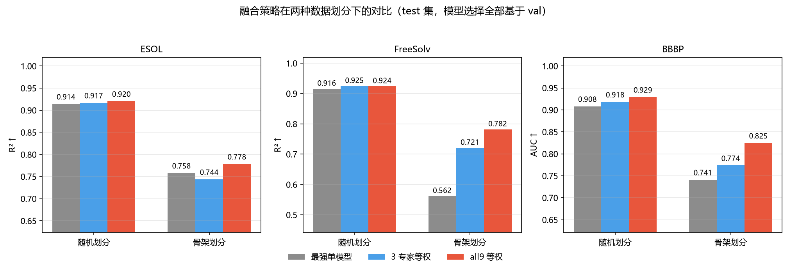

# 基于图神经网络的分子性质预测（CPU 可训的小型 GNN）

**工程实践课题 · 中国科学技术大学软件学院**

利用图神经网络（GCN / GAT / GraphSAGE）在 MoleculeNet 基准数据集（ESOL / FreeSolv / BBBP / Clintox）上预测分子性质（水溶解度、水合自由能、血脑屏障渗透、临床毒性），实现从数据准备、模型训练、多架构对比、特征工程、自监督预训练、不确定性量化、模型融合、可解释性分析到 Web 演示的完整闭环。全部模型在 CPU/低配 GPU 上即可训练。

## 项目亮点

- **4 数据集 × 3 种 GNN 架构 × 3 档特征**，144 个 checkpoint，全部在 CPU 上可训练可推理
- **特征工程**：RDKit 27 维原子特征 + 7 维键特征 + 166 位 MACCS 指纹逐级增强，FreeSolv RMSE 降低 27%，Clintox AUC 提升 17.4 点
- **模型融合研究**（本项目方法创新点）：从误差多样性诊断出发，验证"同构集成无效、异构融合有效"的边界条件，并给出骨架划分（scaffold split）下的鲁棒性证据
- **GraphCL 自监督预训练**：15,289 无标签分子池，小样本任务（FreeSolv）增益最显著
- **不确定性量化**：MC-Dropout 置信区间 + 同构集成（同架构多 seed）+ 异质集成（9 配置 × 4 种子）
- **可解释链**：GNNExplainer 关键原子/键掩码 → GAT 逐头注意力可视化 → LLM 化学解释（DeepSeek API，归因对象随推理模式切换）
- **端到端 Web 演示**：输入 SMILES → 实时预测 + 不确定性 + 结构重要性着色 + LLM 解释
- **CPU 可训**：单模型参数量 < 100k，普通笔记本完成全部训练

## 目录结构

```
GNN分子性质预测/
├── data/                      # MoleculeNet 数据集与特征化缓存（不入库）
├── models/                    # 训练权重（不入库）
│   ├── feat/                  # 特征工程主模型（9 配置 × 4 数据集，seed42）
│   ├── feat_ensemble/         # 额外种子（7/13/21）权重，用于集成
│   ├── feat_scaffold/         # Murcko 骨架划分下的重训权重
│   ├── hybrid/                # HybridAgg 架构级融合（负结果，保留复现）
│   ├── distill/               # 蒸馏学生模型
│   └── ensemble/              # 深度集成成员
├── reports/
│   ├── splits/                # 随机划分 + *_scaffold_split.json 骨架划分
│   ├── diversity/             # 误差相关矩阵、融合预实验、热力图、预测缓存
│   ├── figures/               # 论文级对比图表（含 fusion_split_compare.png）
│   ├── interpret/             # GNNExplainer 解释结果（PNG + JSON）
│   ├── attention/             # GAT 逐头注意力热图（PNG + JSON）
│   ├── comparison_results.json     # 基线架构对比
│   ├── feat_results.json           # 特征工程 36 组结果
│   ├── diversity/error_diversity.json   # 144 checkpoint 误差相关性分析
│   ├── diversity/fusion_preview.json    # 随机划分下 6 种融合策略对比
│   ├── fusion_scaffold.json        # 骨架划分下三方对比
│   ├── hybrid_results.json         # HybridAgg 架构级融合结果
│   ├── distill_results.json        # 蒸馏结果
│   ├── fusion_summary.md           # ★ 融合实验汇总报告
│   └── 项目报告.md                  # ★ 工程实践总报告
├── src/
│   ├── data_prep.py           # 数据下载与预处理
│   ├── featurize.py           # 四档特征工程（BASE/A/B/C）
│   ├── models.py              # GCN / GAT / GraphSAGE / HybridAgg
│   ├── train_eval.py          # 基线训练与评估（可复用训练循环）
│   ├── train_feat.py          # 特征工程实验（支持 --split scaffold）
│   ├── train_feat_ensemble.py # 深度集成训练
│   ├── analyze_error_diversity.py  # 144 checkpoint 误差多样性 + 融合预实验
│   ├── scaffold_split.py      # Murcko 骨架划分
│   ├── train_hybrid.py        # 架构级融合 HybridAgg（负结果）
│   ├── distill_ensemble.py    # 异质集成蒸馏（负结果）
│   ├── fusion_scaffold.py     # 骨架划分下融合验证
│   ├── gen_figures.py         # 全部对比图表
│   ├── contrastive_pretrain.py # GraphCL 自监督预训练
│   ├── finetune_pretrained.py # 预训练模型微调
│   ├── uncertainty.py         # MC-Dropout 不确定性量化
│   ├── interpret.py           # GNNExplainer 可解释性
│   ├── attention_viz.py       # 注意力可视化
│   ├── llm_explain.py         # LLM 化学解释
│   ├── app.py                 # Flask Web 服务与 API
│   └── task_config.py         # 目标列与类别权重统一配置
├── tests/                     # unittest 回归测试
├── requirements.txt
└── README.md
```

## 环境与安装

- Python ≥ 3.10（本项目在 Python 3.13 / Windows 上验证）
- 依赖安装：

```bash
pip install -r requirements.txt
# 若需 CPU 版 torch（可选）：
pip install torch --index-url https://download.pytorch.org/whl/cpu
```

> 注：若遇到 PyG 2.8 + torch 2.14 的 `gcn_norm` in-place 类型提升报错，`src/compat_patch.py`
> 会在导入模型时自动应用兼容补丁，无需手动处理。

## 运行步骤

### 1. 数据准备

```bash
python src/data_prep.py                 # 下载 4 个 MoleculeNet 数据集
python src/featurize.py                 # 生成 BASE/A/B/C 四档特征缓存
```

### 2. 训练与多架构对比

```bash
python src/train_eval.py --convs GCN GAT GraphSAGE --names ESOL FreeSolv BBBP
python src/train_feat.py --names ESOL FreeSolv BBBP Clintox --levels a b c
```

### 3. 融合研究（按顺序复现）

```bash
python src/analyze_error_diversity.py            # 误差相关矩阵 + 融合预实验（零训练）
python src/scaffold_split.py                     # 生成 4 个 Murcko 骨架划分
python src/train_feat.py --split scaffold --names ESOL FreeSolv BBBP --levels a b c
python src/fusion_scaffold.py --names ESOL FreeSolv BBBP   # 骨架划分三方对比
python src/train_hybrid.py --names ESOL BBBP --levels c    # 架构级融合（负结果复现）
python src/distill_ensemble.py --names ESOL BBBP --epochs 300  # 蒸馏（负结果复现）
python src/gen_figures.py                        # 生成全部图表
```

结论与数据解读见 **`reports/fusion_summary.md`**。

### 4. 可解释性分析

```bash
python src/interpret.py --conv GCN --names ESOL FreeSolv BBBP --num 4
```

### 5. 启动 Web 演示

```bash
python src/app.py
```

浏览器访问 **http://127.0.0.1:5000**，支持单模型 / 异质集成（9 配置 × 4 种子）/ MC-Dropout / 同构集成 / GAT 注意力五种分析方式。

如需 LLM 化学解释，配置 DeepSeek API Key 即可（`deepseek_config.json` 或环境变量 `DEEPSEEK_API_KEY`），无需额外依赖，单次约 8 秒；解释的归因对象会跟随当前推理模式（单模型 / MC / 同构集成 / 异质集成 / 注意力）。

## 实验结果汇总

训练配置：hidden=64，3 层图卷积，batch=32，Adam（lr=1e-3，wd=5e-4），early stopping（patience=40）。模型选择基于验证集，test 只评估一次；分类 AUC 为 softmax 概率口径。

### 基线架构对比（9 维特征）

| 数据集 | 指标 | GCN | GAT | GraphSAGE | 最优 |
|---|---|---|---|---|---|
| ESOL | RMSE ↓ | 0.795 | **0.748** | 0.787 | GAT |
| FreeSolv | RMSE ↓ | 2.005 | 2.205 | **1.384** | GraphSAGE |
| BBBP | AUC ↑ | 0.809 | 0.830 | **0.876** | GraphSAGE |
| Clintox | AUC ↑ | 0.711 | **0.724** | 0.641 | GAT |

### 融合效果（test）

| 数据集 | 划分 | 最强单模型 | 异质等权 all9 | 增益 |
|---|---|---|---|---|
| ESOL | 随机 | R² 0.9142 | **0.9205** | +0.6 |
| FreeSolv | 随机 | R² 0.9157 | **0.9241** | +0.8 |
| BBBP | 随机 | AUC 0.9082 | **0.9292** | +2.1 |
| Clintox | 随机 | AUC 0.9120 | **0.9163** | +0.4 |
| ESOL | 骨架 | R² 0.7581 | **0.7785** | +2.0 |
| FreeSolv | 骨架 | R² 0.5618 | **0.7817** | +22.0 |
| BBBP | 骨架 | AUC 0.7411 | **0.8248** | +8.4 |



### 结论

1. **没有单一架构全面胜出**：GAT 在 ESOL 上最优，GraphSAGE 在 FreeSolv / BBBP 上最优。架构选择应结合任务特性。
2. **特征工程收益大于换架构**：RDKit 原子特征贡献最大，MACCS 指纹对回归有效、对分类有限。
3. **融合的有效层级是"模型级"**：同构种子集成（误差相关 0.92）常无增益；跨架构异构集成是唯一在全部数据集-划分组合上提升的方案。
4. **增益随分布外难度递增**：骨架划分下提升幅度（+2.0～+22.0 点）远大于随机划分（+0.6～+2.1 点），且成员数量不足时（3 专家）会失效。
5. **架构级融合与蒸馏均失败**，失败原因可归因：同一计算图内的分支共享梯度会摧毁多样性，单模型容量无法表达集成边界。详见 `reports/fusion_summary.md`。

## 测试记录（验证方式）

- **数据**：MoleculeNet 官方源，RDKit 解析 SMILES 构建分子图，BBBP 中 11 条无法解析的 SMILES 被跳过
- **划分**：随机 8:1:1（seed=42）+ Murcko 骨架划分，索引均落盘
- **训练**：固定种子，early stopping，测试集指标在独立划分上计算
- **可解释性**：GNNExplainer 对 12 个测试集分子生成解释，全部成功
- **Web**：Flask 服务加载模型，页面、静态资源、SMILES 校验、各分析接口均通过实际请求验证
- **回归测试**：`python -m unittest discover -s tests -v`

## 常见问题

- **数据集下载慢**：首次运行需从 deepchemdata S3 下载 CSV（每个约 1-5 MB），网络慢时请重试或代理。
- **PyG 安装失败**：确保 torch 已安装且版本匹配，再安装 torch_geometric；Windows 上推荐预编译 wheel。
- **Web 页面无图**：首次预测需运行 GNNExplainer（约 2-5 秒），属正常等待。
- **骨架划分指标偏低**：属正常现象，同一骨架不出现在训练集时泛化难度显著上升，这正是该划分的价值所在。
