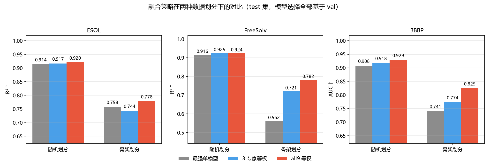

# 融合实验汇总报告

生成时间：2026-11-20　|　协议：hidden=64 / layers=3 / heads=4 / batch=32 / lr=1e-3 / wd=5e-4 / patience=40 / epochs≤300，8:1:1

**统一口径**：模型选择一律基于验证集，test 只评估一次；分类 AUC 为 softmax 正类概率口径；回归误差为原始预测值残差。

---

## 1. 随机划分：三种融合层级的对比

| 数据集 | 最强单模型(val选) | 同构集成(val选) | 异质等权 all9 | HybridAgg(架构级融合) |
|---|---|---|---|---|
| ESOL | RMSE 0.6002 / R² 0.9142 | 0.6118 / 0.9108 | **0.5776 / 0.9205** | 0.7811 / 0.8547 |
| FreeSolv | 1.1461 / 0.9157 | 1.1225 / 0.9191 | **1.0873 / 0.9241** | 未做 |
| BBBP | AUC 0.9082 / F1 0.9030 | 0.9177 / 0.9110 | **0.9292 / 0.9221** | AUC 0.9209 / F1 0.9110 |
| Clintox | AUC 0.9120 / F1 0.4828 | 0.9027 / 0.4828 | **0.9163 / 0.5333** | 未做 |

**读法**：同构集成（同一配置的 4 个种子平均）在 4 个数据集上有 2 个不如最强单模型，说明同构成员的误差高度相关、平均无增益；异质等权 all9 是唯一四数据集全部提升的方案。架构级融合（HybridAgg）在两个数据集上均显著劣于模型级集成。

## 2. Murcko 骨架划分：分布外泛化下的融合

骨架划分按 Murcko 骨架分组，同一骨架只出现在一个集合中（`src/scaffold_split.py`），train:val:test ≈ 8:1:1。Clintox 骨架 test 仅 5 个正样本，指标不可信，未纳入。

| 数据集 | GCN_featc | GAT_featc | SAGE_featc | 最强单模型(val选) | 3 专家等权 | **all9 等权** |
|---|---|---|---|---|---|---|
| ESOL (R²) | 0.7053 | 0.5802 | 0.6321 | 0.7581 | 0.7437 | **0.7785** |
| FreeSolv (R²) | 0.7162 | 0.6776 | 0.7309 | 0.5618 | 0.7209 | **0.7817** |
| BBBP (AUC) | 0.7870 | 0.7435 | 0.7411 | 0.7411 | 0.7736 | **0.8248** |

**读法**：骨架划分下三个数据集的 all9 集成全部优于最强单模型，且**增益幅度大于随机划分**（ESOL +2.0、FreeSolv +22.0、BBBP +8.4 个点，对比随机划分的 +0.6 / +0.8 / +2.1）。FreeSolv 的巨幅提升来自模型选择鲁棒性：val 仅 64 条，val 排序把 test R² 0.562 的模型选成第一，而其余成员在 0.66–0.73 之间，集成摊平了这个选择风险。ESOL 上 3 专家反而低于单模型（0.7437 vs 0.7581），说明难划分下成员数量是硬约束。



## 3. 误差多样性（test 残差平均相关系数，越低融合收益越大）

| 数据集 | 同配置跨种子 | 跨架构 | 同架构跨特征档 | 跨架构（骨架划分） |
|---|---|---|---|---|
| ESOL | 0.918 | 0.606 | 0.570 | 0.725 |
| FreeSolv | 0.914 | 0.750 | 0.712 | 0.650 |
| BBBP | 0.952 | 0.871 | 0.844 | 0.915 |
| Clintox | 0.829 | 0.752 | 0.740 | — |

**读法**：相关性排序为「同配置跨种子 > 同架构跨特征档 > 跨架构」，与融合收益的排序完全一致——这是"多样性来自独立训练轨迹与不同归纳偏置"的直接证据。骨架划分下相关性普遍上升（分布外样本的误差来自同一批"没见过的骨架"，共模成分变强），但集成仍有效，说明平均降低的是方差而非偏差。

## 4. HybridAgg 每层聚合混合权重（4 种子 × 3 层平均）

| 数据集 | 层1 (GCN/GAT/SAGE) | 层2 | 层3 |
|---|---|---|---|
| ESOL | 0.339 / 0.334 / 0.327 | 0.336 / 0.340 / 0.324 | 0.329 / 0.349 / 0.322 |
| BBBP | 0.334 / 0.332 / 0.334 | 0.335 / 0.336 / 0.329 | 0.334 / 0.334 / 0.332 |

**读法**：三层权重全部收敛到 0.33 附近，可学习混合退化为等权平均，未产生任何架构偏好。原因有三：① 三条分支共享同一输入与同一梯度，训练后表示趋同；② 并联加权压缩了各分支的信号幅度；③ 参数 70.6k vs 单模型 57k，在 1128 条样本上容量过剩。变体 v2（残差 + LayerNorm + 温度系数）参数增至 80.9k，ESOL R² 直接崩到 0.4057，已回滚。

## 5. 蒸馏：把集成压成单模型（失败）

教师 = 每数据集 val 选出的 3 专家 × 4 种子等权平均（12 个模型）；学生 = 该数据集 val 最优的单模型配置；损失 = 硬标签 + λ·软标签（回归 MSE，分类 T=2 的 KL，λ=0.5）。

| 数据集 | 单模型基线 | 蒸馏学生（4 种子均值） | 教师（异质集成） |
|---|---|---|---|
| ESOL (RMSE / R²) | 0.6329 / 0.9044 | 0.6749 / 0.8915 | **0.5911 / 0.9168** |
| BBBP (AUC / F1) | 0.9140 / 0.8948 | 0.9125 / 0.9056 | **0.9183 / 0.9103** |

**读法**：ESOL 上学生比基线差 6.6% RMSE；BBBP 上 AUC 持平、仅 F1 微升。失败原因：回归软标签是 12 个模型的均值，抹平了单模型能学到的样本特异细节；学生 57k 参数无法表达 12×57k 集成的决策边界；BBBP 为二分类，软标签携带的类间信息本就很少。

---

## 6. 结论

1. **融合的有效层级是"模型级"，不是"架构级"**。层内并联加权（HybridAgg）与蒸馏压缩均失败，模型级异质等权是唯一在全部数据集-划分组合上稳定提升的方案。
2. **多样性的来源决定融合收益**。同构种子平均（相关 0.92）常无增益甚至倒退；跨架构（相关 0.61–0.87）才产生有效互补。
3. **增益随分布外难度递增**。骨架划分下集成收益（+2.0～+22.0 点）显著大于随机划分（+0.6～+2.1 点），在更接近真实药物筛选的场景中价值更高。
4. **成员数量是难划分下的硬约束**。3 专家在 ESOL 骨架划分上反而低于单模型，必须覆盖全部 9 个「架构 × 特征档」组合。
5. **静态加权不可靠**。NNLS 在 val 上拟合的权重在 FreeSolv、Clintox 上坍缩为单专家（权重 1.0/0/0），等权是更稳的默认选择。

## 7. 复现

```bash
python src/analyze_error_diversity.py          # 144 checkpoint 多样性 + 融合预实验
python src/scaffold_split.py                   # 生成 4 个 Murcko 骨架划分
python src/train_feat.py --split scaffold --convs GCN GAT GraphSAGE --levels a b c
python src/fusion_scaffold.py --names ESOL FreeSolv BBBP   # 骨架划分三方对比
python src/train_hybrid.py --names ESOL BBBP --levels c --seeds 42 7 13 21
python src/distill_ensemble.py --names ESOL BBBP --seeds 42 7 13 21 --epochs 300
python src/gen_figures.py                      # 全部图表
```

## 8. 数据溯源

`reports/diversity/error_diversity.json`、`reports/diversity/fusion_preview.json`、`reports/fusion_scaffold.json`、`reports/hybrid_results.json`、`reports/distill_results.json`、`models/feat/`、`models/feat_ensemble/`、`models/feat_scaffold/`、`models/hybrid/`、`models/distill/`。
