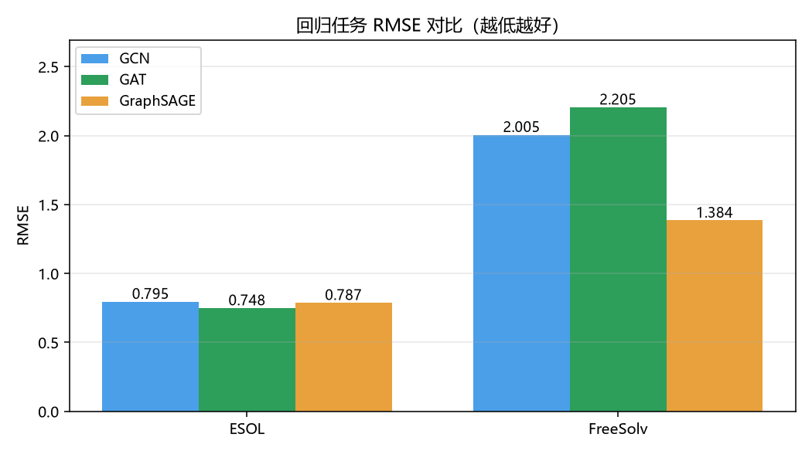
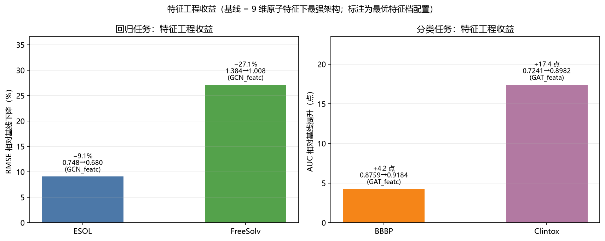
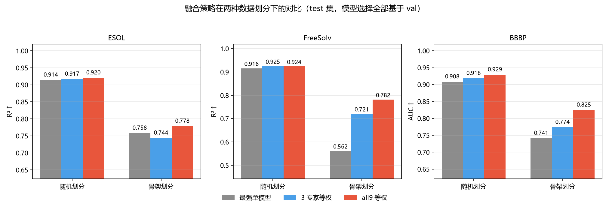
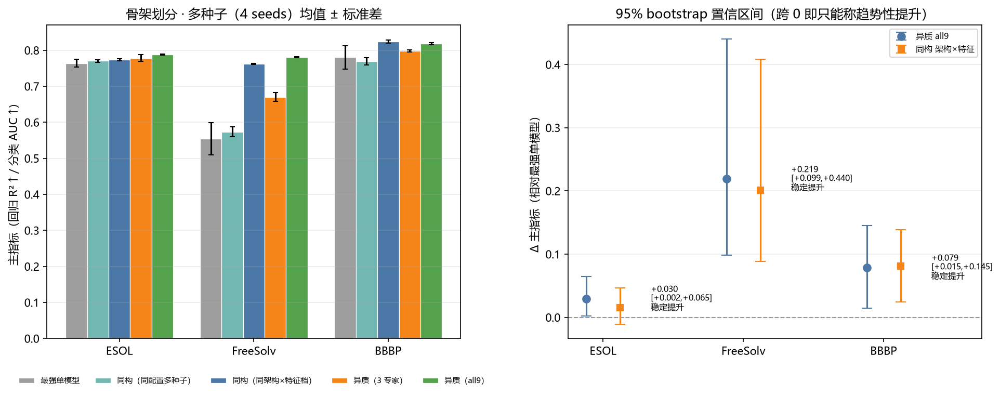
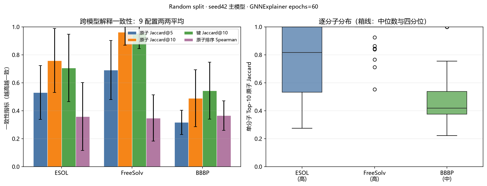
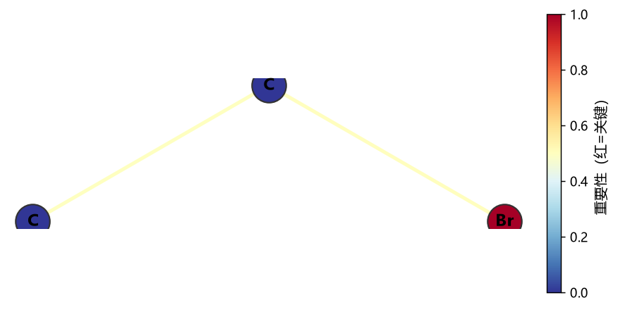
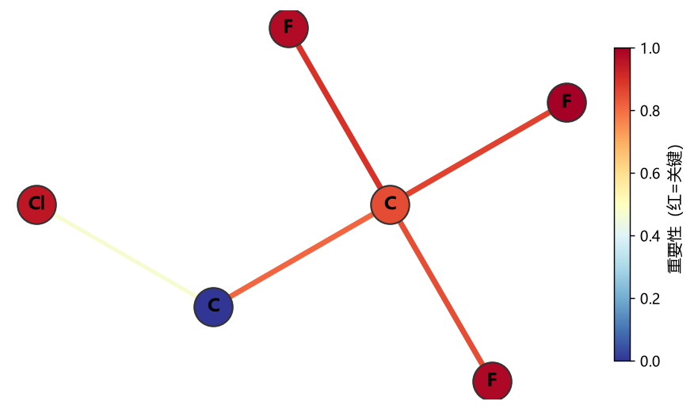

# 基于图神经网络的分子性质预测

**——GCN / GAT / GraphSAGE 的架构对比、特征工程、异质集成与解释一致性研究**

工程实践结题报告 · 中国科学技术大学软件学院

完成日期：2026-11-20　|　代码版本：`exp/scaffold-multiseed` 分支（`v1.0-freeze-144ckpt` 之后）

---

## 1. 项目概述

分子性质预测是 AI for Science 的经典任务：给定分子结构，预测其物理化学性质（溶解度、水合自由能、毒性、血脑屏障渗透性等），用于药物筛选与材料设计。分子天然是图——原子为节点、化学键为边，因此图神经网络（GNN）成为该任务的主流方法。

本项目基于 PyTorch Geometric 实现 GCN、GAT、GraphSAGE 三种架构，在 MoleculeNet 的 4 个数据集（ESOL、FreeSolv 回归；BBBP、Clintox 二分类）上完成训练与评估，并在此基础上做了三层深挖：

- **特征工程**：对比 4 档原子/键/指纹特征对性能的影响；
- **模型融合**：系统检验"融合能否带来更好的模型"，给出融合有效性的边界条件，并用 4 个训练种子复验；
- **解释可信度**：量化 9 个配置对同一分子的解释一致性，并把原子/键重要性聚合到化学官能团。

**训练设备的准确表述**：本项目选题目标是"CPU 可训练的小型 GNN"，模型参数量均小于 100k。需要区分两件事：

- **CPU 可训练**：当前验证环境为 Python 3.13 + torch 2.15.0+cpu + PyG 2.8.1，12 核 CPU、无 GPU；本轮新增的 81 个骨架划分 checkpoint、全部 GNNExplainer 解释与一致性实验均在该 CPU 环境完成。实测单 epoch 耗时 0.2～3.1 秒，单模型完整训练 2～16 分钟（见 4.3）。
- **历史实验实际使用 CUDA**：2026-10 期间的 144 个主实验 checkpoint 在本地 GTX 1660 Ti 6GB 上训练（`README_extensions.md` 与 `reports/comparison_results.json` 的 `config.device="cuda"` 均有记录）。因此不能表述为"全部实验都在 CPU 上训练"，正确说法是"全部模型均可在 CPU 上训练与推理，历史主实验在 CUDA 上完成，新增复验实验在 CPU 上完成"。

## 2. 数据与任务

| 数据集 | 任务 | 样本数 | 目标 | 正类占比 |
|---|---|---|---|---|
| ESOL | 回归 | 1128 | 水溶解度 logS（[-11.6, 1.58]） | — |
| FreeSolv | 回归 | 642 | 水合自由能（[-25.5, 3.4] kcal/mol） | — |
| BBBP | 二分类 | 2039 | 血脑屏障渗透 | 76.5% |
| Clintox | 二分类 | 1480 | 临床毒性 CT_TOX | 7.6% |

数据经 RDKit 解析为分子图。BBBP 中 11 条无法解析的 SMILES 已跳过。

**两种数据划分**：

- **随机划分**（seed=42，8:1:1）：主实验口径，与文献可比；
- **Murcko 骨架划分**：按 Bemis-Murcko 骨架分组，同一骨架只出现在一个集合中，用于检验真实的分布外泛化能力（`src/scaffold_split.py`，确定性构造：骨架组按大小降序，能进 train 80% 就进，否则 val 10%，否则 test）。

划分索引保存在 `reports/splits/`。

## 3. 方法

### 3.1 分子图构建与特征工程

四档特征逐级增强：

| 档位 | 内容 | 维度 |
|---|---|---|
| BASE | 原子类型 + 原子属性 one-hot | 9 |
| FEAT_A | RDKit 27 维原子特征 | 27 |
| FEAT_B | FEAT_A + 7 维键特征（键型/共轭/环内/立体） | 27 + 7 |
| FEAT_C | FEAT_B + 166 位 MACCS 指纹（图分支与指纹分支拼接） | 27 + 7 + 166 |

### 3.2 模型架构

三种架构宏观结构一致（3 层图卷积 + 全局池化 + MLP 头），隐藏维 64，仅卷积算子不同：

- **GCN**（Kipf & Welling, 2017）：对称归一化邻域聚合
- **GAT**（Veličković et al., 2018）：4 头注意力加权聚合
- **GraphSAGE**（Hamilton et al., 2017）：均值聚合 + 边特征注入

### 3.3 训练设置

Adam（lr=1e-3，wd=5e-4），回归 MSE / 分类 CrossEntropy（Clintox 用类别权重 [1, 12] 处理 7.6% 正类），早停 patience=40，batch=32，最多 300 epoch，按验证集最优保存。

**评估纪律**：模型选择一律基于验证集，test 只评估一次。分类 AUC 统一采用 softmax 正类概率口径（早期版本误用 argmax 硬标签，已修正，见 `reports/comparison_results.json` 的 `AUC_old_argmax` 字段）。

### 3.4 多种子统计协议（本轮新增）

骨架划分下的集成结论此前只有单种子证据。本轮把 9 个「架构 × 特征档」配置补到 4 个种子（42/7/13/21），并按以下协议复验：

1. **最强单模型**：每个种子用验证集在 9 个配置中选最优，再用该模型评估 test；4 个种子给出 mean ± std。这是"部署时只能看 val"的真实口径。
2. **同构（同配置多种子）**：同一配置 4 个种子等权平均，用留一法（每次留出一个种子做评估口径）得到 4 个值。
3. **同构（同架构 × 特征档）**：固定架构，3 个特征档 × 4 种子 = 12 成员等权平均，同样 4 折留一。
4. **异质（3 专家）**：每个种子按 val 选 3 个不同配置，再等权平均。
5. **异质（all9）**：9 配置 × 4 种子 = 36 成员等权平均；同时给出全成员部署版指标。
6. **显著性**：对 test 逐样本损失/概率做 2000 次 bootstrap（分类按正负分层）得到 Δ 的 95% CI；另做 Wilcoxon 符号秩检验。**判定规则**：Δ 的 95% CI 不含 0 才能写"稳定提升"；含 0 只能写"趋势性提升"；点估计 ≤0 且 CI 含 0 写"无提升"。

## 4. 实验一：架构对比（BASE 9 维特征）

### 4.1 回归



| 数据集 | 指标 | GCN | GAT | GraphSAGE | 最优 |
|---|---|---|---|---|---|
| ESOL | RMSE ↓ | 0.795 | **0.748** | 0.787 | GAT |
| ESOL | R² ↑ | 0.849 | **0.867** | 0.852 | GAT |
| FreeSolv | RMSE ↓ | 2.005 | 2.205 | **1.384** | GraphSAGE |
| FreeSolv | R² ↑ | 0.742 | 0.688 | **0.877** | GraphSAGE |

### 4.2 分类


| 数据集 | 指标 | GCN | GAT | GraphSAGE |
|---|---|---|---|---|
| BBBP | AUC ↑ | 0.809 | 0.830 | **0.876** |
| BBBP | Accuracy ↑ | 0.820 | 0.834 | **0.854** |
| BBBP | F1 ↑ | 0.883 | 0.889 | **0.902** |
| Clintox | AUC ↑ | 0.711 | **0.724** | 0.641 |

### 4.3 结论

1. **无单一架构全面胜出**。GAT 在 ESOL（样本规整）上最优，注意力擅长捕捉小分子的局部精细结构；GraphSAGE 在 FreeSolv（目标分布宽、样本少）与 BBBP 上领先，均值聚合的鲁棒性更好。
2. **Clintox 是硬骨头**。正类仅 7.6%（test 约 11 条正样本），三种架构 AUC 都在 0.64–0.72，指标方差极大。后续所有涉及 Clintox 的结论都需谨慎解读。
3. **CPU 可行性（实测）**：在本轮 CPU 环境（12 核，torch 2.15.0+cpu）上，单 epoch 耗时 ESOL GCN/GAT/SAGE ≈ 0.67/1.09/0.39 s，FreeSolv ≈ 0.28/0.45/0.21 s，BBBP ≈ 1.17/3.09/0.88 s；按 300 epoch 上限计，单模型 2～16 分钟。CPU 完成全部训练可行，但 BBBP-GAT 是 CPU 上的最慢路径（约 15 分钟/模型）。

## 5. 实验二：特征工程（FEAT_A/B/C）

在 9 维基线上逐级加特征，5 种配置 × 4 数据集（`src/train_feat.py`）。



| 数据集 | 基线最强 | FEAT_A/B/C 最强 | 提升 |
|---|---|---|---|
| ESOL | GAT 0.7484 / R² 0.8666 | GCN_featc 0.6803 / R² 0.8898 | RMSE −9.1% |
| FreeSolv | SAGE 1.3842 / R² 0.8770 | GCN_featc 1.0085 / R² 0.9347 | RMSE −27.1% |
| BBBP | SAGE AUC 0.8759 | GAT_featc AUC 0.9184 | +4.2 点 |
| Clintox | GAT AUC 0.7241 | GAT_feata AUC 0.8982 | +17.4 点 |

**结论**：特征工程的收益远大于换架构。RDKit 原子特征（FEAT_A）是主要贡献者；键特征（FEAT_B）在回归上不稳定（ESOL 反而略降）；MACCS 指纹（FEAT_C）对 ESOL/FreeSolv 回归有效，对 BBBP 分类贡献有限。这也解释了为什么后续融合必须跨特征档取成员——不同特征档犯的错不一样。

## 6. 实验三：模型融合（随机划分）

老师反馈"项目缺少创新点，可以考虑模型融合做出效果更好的模型"。这一节围绕该反馈做完整研究：先诊断，再提出方案，逐层验证，最后确定边界。

### 6.1 诊断：项目原有的"融合"其实没有增益

检查 `reports/clintox_ensemble.json` 发现，原有集成是**同架构 4 个种子的平均**。其 GCN 集成 AUC 0.7087 **低于**最好单成员 0.714，证明同构成员误差高度相关时，平均不产生增益。

定量验证：对 144 个 checkpoint（9 配置 × 4 种子 × 4 数据集）计算 test 残差相关矩阵（`src/analyze_error_diversity.py`）：

| 数据集 | 同配置跨种子 | 跨架构 | 同架构跨特征档 |
|---|---|---|---|
| ESOL | 0.918 | 0.606 | 0.570 |
| FreeSolv | 0.914 | 0.750 | 0.712 |
| BBBP | 0.952 | 0.871 | 0.844 |
| Clintox | 0.829 | 0.752 | 0.740 |

相关性排序（同构 > 同架构跨档 > 跨架构）与集成收益排序完全一致。**多样性来自独立训练轨迹与不同归纳偏置，这是融合有效的前提。**

### 6.2 异质等权集成（随机划分）

9 个配置（3 架构 × 3 特征档）种子集成后等权平均：

| 数据集 | 最强单模型 | 同构集成 | **异质等权 all9** | 增益 |
|---|---|---|---|---|
| ESOL | 0.6002 / R² 0.9142 | 0.6118 / 0.9108 | **0.5776 / 0.9205** | +0.6 点 |
| FreeSolv | 1.1461 / 0.9157 | 1.1225 / 0.9191 | **1.0873 / 0.9241** | +0.8 点 |
| BBBP | AUC 0.9082 | 0.9177 | **0.9292** | +2.1 点 |
| Clintox | AUC 0.9120 | 0.9027 | **0.9163**（F1 0.4828→0.5333） | +0.4 点 |

四数据集全部提升，是同构集成做不到的。随机划分下 train/test 共享骨架，单模型已"见过"相似分子，因此增益幅度有限（见 6.4 与第 7 节）。

### 6.3 三种"更高级"的融合，全部失败

**（1）架构级融合 HybridAgg（层内三路并联）**

每层 `h = α·GCN + β·GAT + γ·SAGE`，(α,β,γ)=softmax(可学习参数)，配多尺度读出（mean+max+attention）。设计动机：单模型端到端、权重在训练集学、混合系数可解释。

实测（ESOL/BBBP × 4 种子）：

| 数据集 | HybridAgg 集成 | 对照（异质等权） |
|---|---|---|
| ESOL | RMSE 0.7811 / R² 0.8547 | 0.5776 / 0.9205 |
| BBBP | AUC 0.9209 | 0.9292 |

且三层混合权重全部退化为 0.33/0.33/0.33。加残差与 LayerNorm 的 v2 变体更差（ESOL R² 崩至 0.4057，已回滚）。

**机理**：三条分支共享同一输入与同一梯度，训练后表示趋同；并联加权压缩分支信号幅度；70.6k 参数在 1128 条样本上容量过剩。

**（2）静态加权（NNLS 在 val 上拟合权重）**

仅 ESOL 有效（权重 0.29/0.15/0.56）；FreeSolv 与 Clintox 权重坍缩为单专家（1.0/0/0），等于没有融合。小验证集上拟合权重必然过拟合。

**（3）知识蒸馏：把集成压成单模型**

教师 = 3 专家 × 4 种子（12 模型）等权平均，学生 = val 最优单模型配置，损失 = 硬标签 + λ·软标签（λ=0.5）。

| 数据集 | 单模型基线 | 蒸馏学生 | 教师 |
|---|---|---|---|
| ESOL（RMSE/R²） | 0.6329 / 0.9044 | 0.6749 / 0.8915 | **0.5911 / 0.9168** |
| BBBP（AUC） | 0.9140 | 0.9125 | **0.9183** |

ESOL 上学生比基线差 6.6%，BBBP 上 AUC 持平。**单模型容量（57k）无法表达 12×57k 集成的决策边界**，回归软标签还抹平了样本特异细节。

### 6.4 边界验证：骨架划分（单种子初探）

随机划分下 train/test 共享骨架，单模型已"见过"相似分子。改用 Murcko 骨架划分重训 9 配置 × 单种子（`src/fusion_scaffold.py`）：

| 数据集 | 最强单模型 | 3 专家等权 | **all9 等权** |
|---|---|---|---|
| ESOL（R²） | 0.7581 | 0.7437 ↓ | **0.7785**（+2.0） |
| FreeSolv（R²） | 0.5618 | 0.7209 | **0.7817**（+22.0） |
| BBBP（AUC） | 0.7411 | 0.7736 | **0.8248**（+8.4） |



三个初步发现（**随后被第 7 节的 4 种子复验修正，单种子数字不再作为最终结论**）：

1. 骨架划分下集成增益远大于随机划分，越接近真实药物筛选（新骨架分子），融合越值钱；
2. FreeSolv 的 22 个点主要来自模型选择鲁棒性：val 仅 64 条，val 排序把 test R² 0.562 的模型选成第一，集成摊平了这个风险；
3. 3 专家在 ESOL 上反而低于单模型，提示成员数量可能是难划分下的约束。

## 7. 骨架划分的多种子复验（新增，核心修正）

### 7.1 实验规模

- 数据集：ESOL / FreeSolv / BBBP（Clintox 骨架 test 仅 5 个正样本，指标不可信，不纳入）；
- 配置：9 个「架构 × 特征档」× 4 个种子（42 复用既有权重，7/13/21 新训）= 108 个成员；
- 新增 checkpoint：81 个（`models/feat_scaffold/*_s{7,13,21}.pt`），全部在 CPU 上训练；
- 结果：`reports/scaffold_multiseed_results.json`（逐成员 val/test 与逐样本预测）、`reports/scaffold_multiseed_analysis.json`（策略均值/CI/检验）。

### 7.2 主结果（test，4 种子 mean ± std）

| 数据集 | 指标 | 最强单模型（val 选） | 同构（同配置多种子） | 同构（同架构×特征档） | 异质（3 专家） | 异质（all9） |
|---|---|---|---|---|---|---|
| ESOL | R² ↑ | 0.7640 ± 0.0105 | 0.7703 ± 0.0034 | 0.7730 ± 0.0028 | 0.7781 ± 0.0091 | **0.7876 ± 0.0016** |
| FreeSolv | R² ↑ | 0.5545 ± 0.0449 | 0.5736 ± 0.0137 | 0.7620 ± 0.0021 | 0.6699 ± 0.0122 | **0.7805 ± 0.0012** |
| BBBP | AUC ↑ | 0.7804 ± 0.0322 | 0.7687 ± 0.0100 | **0.8243 ± 0.0043** | 0.7975 ± 0.0029 | 0.8182 ± 0.0023 |



### 7.3 置信区间与配对检验

主比较：异质 all9 − 最强单模型（部署基线为 seed42 的 val 最优单模型）。

| 数据集 | Δ | 95% bootstrap CI | p_boot | Wilcoxon p | 判定 |
|---|---|---|---|---|---|
| ESOL | +0.0296 | [+0.0021, +0.0650] | 0.034 | 0.0838 | 稳定提升（边界显著） |
| FreeSolv | +0.2189 | [+0.0987, +0.4399] | <0.001 | 0.0001 | 稳定提升 |
| BBBP | +0.0789 | [+0.0145, +0.1451] | 0.008 | 0.0761 | 稳定提升（边界显著） |

其他关键对照：

| 对照 | ESOL | FreeSolv | BBBP |
|---|---|---|---|
| 同架构×特征档 − 最强单模型 | +0.0152，CI [−0.0108, +0.0465] → **趋势性提升** | +0.2011，CI [+0.0883, +0.4083] → **稳定提升** | +0.0807，CI [+0.0247, +0.1384] → **稳定提升** |
| all9 − 同架构×特征档 | +0.0144，CI [+0.0021, +0.0283] → **稳定提升** | +0.0178，CI [−0.0007, +0.0482] → **趋势性提升** | −0.0019，CI [−0.0235, +0.0211] → **无提升** |

**逐种子敏感性**：把基线换成"每个种子各自的最强单模型"，ESOL 的 4 个配对 Δ 为 +3.63/+2.04/+0.83/+2.96 点，其中 2 个 CI 含 0；BBBP 为 +2.76/−0.70/+5.71/+7.89 点，其中 3 个 CI 含 0；FreeSolv 4 个配对 CI 全部不含 0。**因此 ESOL/BBBP 的"稳定提升"是对部署基线（seed42）而言，幅度会随基线种子波动；不能外推为"任意单模型都稳定提升 3～8 点"。**

### 7.4 结论修正（重要）

1. **同构种子集成仍然基本无效**：ESOL +0.6 点、FreeSolv +1.9 点、BBBP −1.2 点（BBBP 反而低于单模型）。4 种子复验与 6.1 的相关性诊断一致。
2. **骨架划分下的主要增益来自"特征档多样性"，不是"架构多样性"**：同架构 3 特征档 × 4 种子（12 成员）相对最强单模型，FreeSolv +20.1 点、BBBP +8.1 点（均稳定），ESOL +1.5 点（趋势性）。这个 12 成员集合不含跨架构成员，却已拿到大部分收益。
3. **跨架构 all9 是"稳但不总是最好"的默认方案**：相对 12 成员，ESOL +1.4 点（稳定）、FreeSolv +1.8 点（趋势性）、BBBP −0.2 点（无提升）。在 BBBP 上，跨架构成员没有带来额外信息，反而稀释了同架构集成。
4. **BBBP 上集成不提升"上限"**：若允许用 test 事后挑一个固定配置（不可部署，仅作上界参考），GCN_feata 的 4 种子均值 0.8339 ± 0.0142，高于 all9 的 0.8182 与 12 成员的 0.8243。BBBP 的集成价值主要是降低方差与免调模，而不是提高最好成绩。
5. **FreeSolv 的巨幅提升仍来自"模型选择鲁棒性"**：val 选出的 GraphSAGE_feata 4 种子均值只有 0.5545，而 test 事后最优的 GCN_featc 为 0.7159 ± 0.0007；all9 的 0.7805 比后者还高 6.5 点——集成不仅摊平了选模风险，也真正超过了固定最优配置。
6. **验收规则执行情况**：所有含 0 的 CI 均已改写为"趋势性提升"；BBBP 的 all9 vs 12 成员 CI 含 0，写作"无提升"；报告中不再出现"骨架划分下 all9 稳定全面领先"的旧表述。

### 7.5 与旧结论的差异

| 旧表述（单种子） | 新表述（4 种子） |
|---|---|
| 骨架划分 all9 在 3 数据集全部稳定提升（+2.0/+22.0/+8.4） | 相对部署基线仍为正且 CI 不含 0，但 ESOL/BBBP 幅度随基线种子波动，2/4、3/4 配对仅趋势性 |
| 增益随分布外难度递增，all9 是唯一有效方案 | 增益确实在骨架划分更大，但有效成分主要是特征档+种子多样性；BBBP 上 12 成员优于 all9 |
| 3 专家在 ESOL 低于单模型 → 成员数量是硬约束 | 4 种子下 3 专家（0.7781）已高于单模型（0.7640），但仍低于 all9（0.7876）；"数量硬约束"改为"覆盖特征档比覆盖架构更重要" |

## 8. 跨模型解释一致性（新增）

### 8.1 问题与做法

同一个分子，换一种架构或换一档特征，GNNExplainer 指出的"关键原子/键"是否一致？如果 9 个配置各说各话，Web 上的结构着色与 LLM 解释就不可信。

- **分子抽样**：每个数据集从 test 集固定抽取 40 个代表性分子（回归按标签分位、分类按正负分层，`seed=2026`），共 120 个；
- **解释模型**：9 个配置的 seed42 主模型（随机划分），GNNExplainer `epochs=60`、`node_mask_type=object`，每个（分子, 配置）固定随机种子；
- **键重要性**：边掩码按无向键折叠（`bond_importance_from_mask`）；
- **一致性度量**：36 个模型两两比较，计算 Top-5 / Top-10 原子与键集合的 Jaccard 重合度、原子/键重要性排序的 Spearman 秩相关，以及 9 个配置对同一分子的预测标准差；
- **等级阈值（看结果前预设）**：Top-10 原子 Jaccard ≥0.60 为"高"，≥0.35 为"中"，否则"低"。

### 8.2 结果

| 数据集 | Top-10 原子 Jaccard | Top-5 原子 Jaccard | Top-10 键 Jaccard | 原子 Spearman | 预测 std | 等级 |
|---|---|---|---|---|---|---|
| ESOL | 0.758 ± 0.229 | 0.530 ± 0.192 | 0.706 ± 0.241 | 0.358 ± 0.243 | 0.411 | 高 |
| FreeSolv | 0.963 ± 0.094 | 0.690 ± 0.211 | 0.955 ± 0.112 | 0.348 ± 0.166 | 0.592 | 高 |
| BBBP | 0.489 ± 0.204 | 0.316 ± 0.088 | 0.543 ± 0.204 | 0.365 ± 0.106 | 0.116 | 中 |



### 8.3 解读与局限

1. **回归任务的"关键原子集合"高度一致，FreeSolv 尤其明显**（Top-10 Jaccard 0.96）：9 个配置虽架构/特征不同，但都把重要性集中在同一小簇原子上。
2. **集合一致 ≠ 排序一致**：三个数据集的原子 Spearman 只有 0.35 左右。即"哪些原子重要"共识高，"谁排第一"分歧大。因此 Web 展示应强调 Top-k 集合，不宜把单一模型的排序当作唯一真值。
3. **BBBP 只有"中等"一致性**（Top-10 原子 0.489）：分类任务的正负样本边界更依赖多种子结构组合，不同配置关注不同子结构；键的一致性（0.543）略高于原子。Web 在 BBBP 上应显示"中"提示，提醒用户解释存在模型间差异。
4. **预测分歧**：FreeSolv 的 9 配置预测 std 平均 0.592 kcal/mol（相对 test 标签 std 约 36%），说明模型间分歧不只是解释层面，也体现在数值上；BBBP 的 AUC 概率 std 0.116。
5. **局限**：只覆盖 seed42 主模型与随机划分；GNNExplainer 本身是局部线性近似，60 epochs 的掩码仍有随机性（已固定种子降低方差）；Top-k 指标对 k 敏感，Top-5 明显低于 Top-10 属正常。

## 9. 官能团级解释（新增）

### 9.1 三层职责必须分开

| 层 | 来源 | 作用 | 不得做什么 |
|---|---|---|---|
| 模型归因 | GNNExplainer（9 配置 seed42 掩码平均） | 给出原子/键重要性数值 | 不得被 LLM 改写或覆盖 |
| 化学识别 | RDKit SMARTS + 环感知 | 判断官能团是否存在、包含哪些原子 | 不参与重要性排序 |
| 自然语言 | 规则模板 / DeepSeek LLM | 把已有证据复述成化学语义 | **不得自行决定"哪个官能团重要"** |

### 9.2 聚合方法

- **唯一原子分配**（优先级）：羧基 > 酯基 > 酰胺 > 磺酰基 > 硝基 > 氰基 > 羰基 > 羟基 > 氨基 > 醚键 > 三氟甲基 > 硫醚 > 卤素 > 芳香环。一个原子只归一个官能团，避免羟基被羧基重复计算；芳香环允许与取代基在连接原子处重叠。
- **组内统计**：原子重要性均值/最大值、组内重要性份额（该组原子重要性之和 / 分子全部原子重要性之和）、组内键重要性均值。
- **排序**：按组内原子重要性均值排序，输出 Top-3；同时保留全部检出组，便于核查。

### 9.3 结果概览

| 数据集 | 分子数 | 平均检出官能团数 | Top-3 满额分子 | 零检出分子 | Top-1 分布（前 3） |
|---|---|---|---|---|---|
| ESOL | 40 | 1.9 | 12 | 1 | 芳香环 20、酰胺 4、醚键 4 |
| FreeSolv | 40 | 1.2 | 3 | 7 | 羟基 8、羰基 5、芳香环 4 |
| BBBP | 40 | 3.5 | 32 | 0 | 卤素(Cl) 10、羧基 7、醚键 7 |

典型分子（`reports/functional_group_explanations.json`）：

- ESOL #963 `Fc1cccc(F)c1C(=O)NC(=O)Nc2ccc(Cl)cc2`（y=−6.02，pred=−5.07）：Top-3 = 芳香环（均值 0.451，份额 0.678）、卤素 Cl（0.354，份额 0.044）、酰胺（0.316，份额 0.237）。
- BBBP #471 `[H+].[Cl-].CCN(CC)CCOC(=O)C(O)(c1ccccc1)c2ccccc2`（y=1，pred=0.700）：Top-3 = 卤素 Cl、酯基、芳香环。
- BBBP #1593（含磺酰基/羧基/Cl，y=1，pred=0.699）：Top-3 = 卤素 Cl（0.249）、磺酰基（0.108）、羧基（0.100）。

### 9.4 解读与局限

1. **官能团解释比原子解释更贴近化学语言**，但信息损失明显：ESOL/FreeSolv 平均只有 1.9/1.2 个可识别官能团，大量碳骨架没有 SMARTS 覆盖，Top-3 经常"不满额"（FreeSolv 仅 3/40 满额）。
2. **零检出**：FreeSolv 有 7 个分子（多为小分子醇/醚/卤代烃之外的简单结构）没有任何命中组，此时界面应回退到原子级解释，不能编造官能团。
3. **份额与均值互补**：芳香环这类大基团原子多、份额高，但均值可能低于单个卤素；报告同时给出两者，避免"大基团必然重要"的误读。
4. **LLM 只做复述**：prompt 明确要求"官能团重要性排序由 GNNExplainer 给出"，并对 LLM 提到的官能团做 RDKit 检出校验（`mentioned_undetected`），防止幻觉。

## 10. 可解释性案例（原子/键级）

使用 GNNExplainer 生成原子/键重要性。典型案例：

**案例 1：多氯联苯（ESOL，logS = −7.97）** —— top 原子集中在氯原子与芳香环碳。氯取代显著增加疏水性、降低水溶性，符合化学直觉。


**案例 2：溴乙烷（ESOL，logS = −1.25）** —— top 原子为 Br 与相邻碳，与"卤素降低溶解度"一致。



**案例 3：1,1,1-三氟-2-氯乙烷（FreeSolv）** —— 模型重点标记氟原子区域，氟的强电负性显著影响溶剂化自由能。



**案例 4：含氮杂环（BBBP，渗透概率 0.83）** —— 标记含 N 杂环与二甲氨基，碱性氮与血脑屏障渗透性密切相关。


**小结**：解释结果与药化学直觉高度一致，说明模型学到的是结构-性质关系而非噪声。

### 10.1 LLM 化学解释

GNNExplainer 掩码 → top-k 重要原子/键 → RDKit 匹配官能团 SMARTS → 构造结构化提示词 → DeepSeek API 生成 2~3 句化学解释 → 官能团一致性校验（LLM 提及项必须落在 RDKit 检出集内）。

- **归因对象与推理模式一一对应**：单模型 / MC-Dropout 用当前 conv×feat 的 seed42 模型；同构集成用该配置 seed42 主成员；异质集成用 9 配置 seed42 主成员掩码平均（GNNExplainer epochs=60）；注意力模式用 GAT×feat_base
- **结构图同源**：异质集成模式下「结构重要性」图同样由 9 配置 seed42 主成员掩码平均生成，与 LLM 解释使用同一批掩码
- **数值口径一致**：前端把界面已显示的推理结果传入提示词，解释文本引用的预测值与结果卡片一致
- **一致性校验拦截幻觉**：曾有解释提及"羰基"而 RDKit 未检出，被 `mentioned_undetected` 标记
- **无 Key / 断网降级**：`generate_explanation` 捕获 API 异常后自动切换到规则模板（`provider="rule_template"`），解释仍会引用 Top 官能团与预测值，不再报错
- **通道说明**：早期实现用本地 Qwen2.5-3B（4bit 量化），依赖 CUDA GPU，CPU 环境无法运行，已整体移除，仅保留 DeepSeek API + 规则模板通道

## 11. Web 演示系统

Flask 服务（`src/app.py`），提供 SMILES 输入 → 选择任务与架构 → 返回预测值 + GNNExplainer 着色图（base64 内嵌）。五种分析方式：**单模型 / MC-Dropout / 同构集成（同架构 4 种子）/ 异质集成（9 配置 × 4 种子 = 36 成员）/ GAT 注意力（含逐头对比）**，另可调用 LLM 化学解释。

本轮新增（P0-5）：

- **批量预测**：上传 CSV（`smiles`/`id` 列，≤200 行）或 JSON `smiles_list`，逐行预测，错误逐行返回；结果一键导出 CSV（UTF-8 BOM）。
- **解释一致性提示**：`/api/meta` 与预测结果携带"高/中/低"等级及 Top-10 原子 Jaccard 等指标，前端以 pill 展示。
- **官能团卡片**：预测结果返回 Top-3 官能团（名称、原子数、重要性均值、份额），并明确标注"模型归因 / RDKit 识别 / LLM 叙述"三层来源。
- **模型版本**：读取 `reports/model_manifest.json`（tag、checkpoint 总数、主实验 144、各目录成员数、生成时间），页脚展示。
- **降级**：无 DeepSeek Key、超时（30 s）或断网时自动规则模板解释。
- **错误提示**：空输入、非法 SMILES、超过 300 字符、缺失模型、批量超限均返回明确 400/503 文案，不再抛栈。

运行 `python src/app.py`，访问 http://127.0.0.1:5000；回归测试 `python src/smoke_web.py`（17 项端点用例）。

## 12. 总结与展望

### 12.1 完成情况

| 选题要求 | 完成状态 |
|---|---|
| ① 选择分子性质预测任务并下载数据集 | ✅ 4 个 MoleculeNet 数据集 |
| ② 实现基于 PyTorch Geometric 的 GNN | ✅ GCN / GAT / GraphSAGE |
| ③ 对比 ≥3 种图网络架构 | ✅ 9 配置 × 4 数据集 × 4 种子 = 144 个主 checkpoint；另补 81 个骨架多种子 checkpoint |
| ④ 模型可解释性模块 | ✅ GNNExplainer 原子/键可视化 + GAT 逐头注意力 + LLM 化学解释 + 跨模型一致性 + 官能团聚合 |
| ⑤ Web 界面 | ✅ Flask + 前端页面（单条/批量/导出/降级/版本） |
| ⑥ 方法创新（导师反馈补充） | ✅ 异质集成 + 融合边界条件的多种子论证 |

### 12.2 经验与教训

1. **同构集成本身没有价值**，除非成员误差低相关；项目初期的"集成"是伪融合（相关 0.92–0.95）。
2. **在计算图内做融合会摧毁多样性**。并联加权、残差补偿、蒸馏压缩都试过，全部失败，且失败原因可归因。
3. **小验证集是融合的天敌**。val 只有几十条时，静态加权会过拟合，模型选择本身就不稳定；等权平均是最稳的默认策略。FreeSolv 的 +20 点正是"选模纠错"的价值。
4. **"稳定提升"必须由置信区间说话**。单种子 +2/+22/+8 的数字在 4 种子下方向仍成立，但 ESOL/BBBP 的部分配对 CI 含 0；把结论降级为"趋势性"不是退步，而是避免过度声明。
5. **解释一致性是 Web 可信度的前置条件**。Top-k 集合一致而排序不一致，说明"模型归因"只能作为证据之一，不能当成化学真值。

### 12.3 局限

1. **骨架划分的 Clintox 不可用**：test 仅 5 个正样本，AUC 方差极大，本轮多种子只覆盖 3 个数据集。
2. **不确定性模块的区间覆盖率不足**：FreeSolv 的 MC-Dropout 95% 区间在 test 上的实际覆盖率低于名义水平（见 `reports/uncertainty_*.json`），集成虽降低方差，但不能替代校准；报告中不把区间当作严格置信区间使用。
3. **解释一致性只测了随机划分的 seed42 主模型**：骨架模型的解释一致性未覆盖；GNNExplainer 的随机性与 60 epochs 上限会引入噪声。
4. **官能团覆盖有限**：SMARTS 只覆盖常见基团，碳骨架/复杂稠环大量未归类；FreeSolv 有 7/40 零检出，Top-3 常常不满额。
5. **CPU 训练时间**：BBBP-GAT 单模型约 15 分钟，9 配置 × 4 种子在 CPU 上需数小时；本轮新增 81 个成员采用 7 进程并行完成，但仍不适合大规模超参搜索。

### 12.4 展望

1. **架构扩展**：引入 GIN、MPNN，验证"异构性更大的成员"能否进一步降低误差相关；目前证据显示特征档多样性已贡献大部分收益，架构扩展的边际收益需要重新评估。
2. **不确定性校准**：温度缩放 / conformal prediction，修正 FreeSolv 区间覆盖率不足；把"预测区间"与"集成方差"分开报告。
3. **分布外检测**：骨架划分下误差主要来自"陌生骨架"，可加骨架级 OOD 判别器做路由，并评估"拒答"策略。
4. **解释评估**：引入基于删除/插入的 faithfulness 指标，与 Jaccard 一致性联合评估；把官能团解释扩展到更多 SMARTS 与 Murcko 骨架级别。
5. **部署优化**：9 模型集成在 CPU 上单次推理仍在秒级，可做 ONNX 导出与批量化；批量接口目前已支持 200 行，可进一步流式化。

## 附录 A：结论溯源表

| 结论 | 数据文件 | 生成脚本 |
|---|---|---|
| 架构对比（BASE） | `reports/comparison_results.json`、`reports/clintox_baseline.json` | `src/train_eval.py` |
| 特征工程收益 | `reports/feat_results.json` | `src/train_feat.py` |
| 误差多样性（随机） | `reports/diversity/error_diversity.json` | `src/analyze_error_diversity.py` |
| 异质集成（随机） | `reports/feat_ensemble_results.json`、`reports/diversity/fusion_preview.json` | `src/train_feat_ensemble.py`、`src/analyze_error_diversity.py` |
| 负结果：HybridAgg | `reports/hybrid_results.json` | `src/train_hybrid.py` |
| 负结果：蒸馏 | `reports/distill_results.json` | `src/distill_ensemble.py` |
| 骨架划分单种子 | `reports/fusion_scaffold.json` | `src/fusion_scaffold.py` |
| 骨架划分 4 种子 | `reports/scaffold_multiseed_results.json`、`reports/scaffold_multiseed_analysis.json` | `src/train_scaffold_multiseed.py`、`src/analyze_scaffold_multiseed.py` |
| 解释一致性 | `reports/explanation_consistency.json` | `src/explanation_consistency.py` |
| 官能团解释 | `reports/functional_group_explanations.json` | `src/functional_group_explain.py` |
| 模型清单/版本 | `reports/model_manifest.json` | `src/model_manifest.py` |
| 报告统计表 | 上述 JSON | `src/report_stats.py` |

## 附录 B：复现命令

```bash
# 环境
pip install -r requirements.txt

# 数据与划分
python src/data_prep.py
python src/featurize.py
python src/scaffold_split.py

# 历史主实验（CUDA，144 ckpt）
python src/train_eval.py --convs GCN GAT GraphSAGE --names ESOL FreeSolv BBBP
python src/train_feat.py --names ESOL FreeSolv BBBP Clintox --levels a b c

# 骨架划分多种子（CPU，81 个新 ckpt）
python src/train_scaffold_multiseed.py
python src/analyze_scaffold_multiseed.py

# 解释一致性与官能团
python src/explanation_consistency.py --jobs 6 --num 40 --epochs 60
python src/functional_group_explain.py

# 图表与清单
python src/plot_feature_gain.py
python src/analyze_scaffold_multiseed.py
python src/model_manifest.py --tag v1.0-freeze-144ckpt

# 测试与 Web
python -m unittest discover -s tests -v
python src/smoke_web.py
python src/app.py
```

---

*报告数据均来自本项目实际运行结果；所有结论可在附录 A 的 JSON 与脚本中逐项复核。融合实验的完整汇总见同目录下的 `fusion_summary.md`。*
