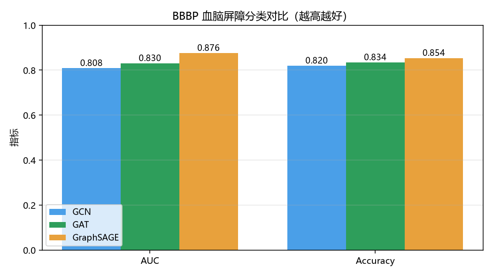
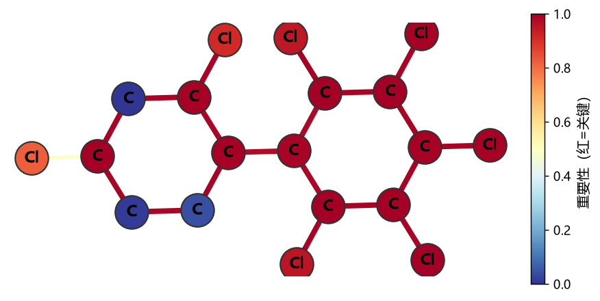
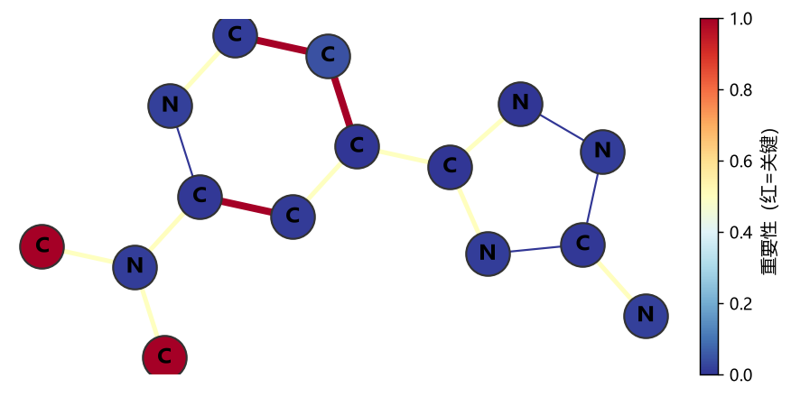

# 基于图神经网络的分子性质预测

**——GCN / GAT / GraphSAGE 的架构对比、特征工程与异质集成研究**

工程实践报告 · 中国科学技术大学软件学院

---

## 1. 项目概述

分子性质预测是 AI for Science 的经典任务：给定分子结构，预测其物理化学性质（溶解度、水合自由能、毒性、血脑屏障渗透性等），用于药物筛选与材料设计。分子天然是图——原子为节点、化学键为边，因此图神经网络（GNN）成为该任务的主流方法。

本项目基于 PyTorch Geometric 实现 GCN、GAT、GraphSAGE 三种架构，在 MoleculeNet 的 4 个数据集（ESOL、FreeSolv 回归；BBBP、Clintox 二分类）上完成训练与评估，并在此基础上做了两层深挖：

- **特征工程**：对比 4 档原子/键/指纹特征对性能的影响；
- **模型融合**：系统检验"融合能否带来更好的模型"，并给出融合有效性的边界条件。

全部模型在 CPU 上即可训练（单分子仅几十个节点），符合选题的资源约束。

## 2. 数据与任务

| 数据集 | 任务 | 样本数 | 目标 | 正类占比 |
|---|---|---|---|---|
| ESOL | 回归 | 1128 | 水溶解度 logS（[-11.6, 1.58]） | — |
| FreeSolv | 回归 | 642 | 水合自由能（[-25.5, 3.4] kcal/mol） | — |
| BBBP | 二分类 | 2039 | 血脑屏障渗透 | 76.5% |
| Clintox | 二分类 | 1480 | 临床毒性 CT_TOX | 7.6% |

数据经 RDKit 解析为分子图。BBBP 中 11 条无法解析的 SMILES 已跳过。

**两种数据划分**：

- **随机划分**（seed=42，8:1:1）：主实验口径，与文献可比；
- **Murcko 骨架划分**：按 Bemis-Murcko 骨架分组，同一骨架只出现在一个集合中，用于检验真实的分布外泛化能力（`src/scaffold_split.py`，确定性构造：骨架组按大小降序，能进 train 80% 就进，否则 val 10%，否则 test）。

划分索引保存在 `reports/splits/`。

## 3. 方法

### 3.1 分子图构建与特征工程

四档特征逐级增强：

| 档位 | 内容 | 维度 |
|---|---|---|
| BASE | 原子类型 + 原子属性 one-hot | 9 |
| FEAT_A | RDKit 27 维原子特征 | 27 |
| FEAT_B | FEAT_A + 7 维键特征（键型/共轭/环内/立体） | 27 + 7 |
| FEAT_C | FEAT_B + 166 位 MACCS 指纹（图分支与指纹分支拼接） | 27 + 7 + 166 |

### 3.2 模型架构

三种架构宏观结构一致（3 层图卷积 + 全局池化 + MLP 头），隐藏维 64，仅卷积算子不同：

- **GCN**（Kipf & Welling, 2017）：对称归一化邻域聚合
- **GAT**（Veličković et al., 2018）：4 头注意力加权聚合
- **GraphSAGE**（Hamilton et al., 2017）：均值聚合 + 边特征注入

### 3.3 训练设置

Adam（lr=1e-3，wd=5e-4），回归 MSE / 分类 CrossEntropy（Clintox 用类别权重 [1, 12] 处理 7.6% 正类），早停 patience=40，batch=32，最多 300 epoch，按验证集最优保存。

**评估纪律**：模型选择一律基于验证集，test 只评估一次。分类 AUC 统一采用 softmax 正类概率口径（早期版本误用 argmax 硬标签，已修正，见 `reports/comparison_results.json` 的 `AUC_old_argmax` 字段）。

## 4. 实验一：架构对比（BASE 9 维特征）

### 4.1 回归

| 数据集 | 指标 | GCN | GAT | GraphSAGE | 最优 |
|---|---|---|---|---|---|
| ESOL | RMSE ↓ | 0.795 | **0.748** | 0.787 | GAT |
| ESOL | R² ↑ | 0.849 | **0.867** | 0.852 | GAT |
| FreeSolv | RMSE ↓ | 2.005 | 2.205 | **1.384** | GraphSAGE |
| FreeSolv | R² ↑ | 0.742 | 0.688 | **0.877** | GraphSAGE |

### 4.2 分类

| 数据集 | 指标 | GCN | GAT | GraphSAGE |
|---|---|---|---|---|
| BBBP | AUC ↑ | 0.809 | 0.830 | **0.876** |
| BBBP | Accuracy ↑ | 0.820 | 0.834 | **0.854** |
| BBBP | F1 ↑ | 0.883 | 0.889 | **0.902** |
| Clintox | AUC ↑ | 0.711 | **0.724** | 0.641 |

### 4.3 结论

1. **无单一架构全面胜出**。GAT 在 ESOL（样本规整）上最优，注意力擅长捕捉小分子的局部精细结构；GraphSAGE 在 FreeSolv（目标分布宽、样本少）与 BBBP 上领先，均值聚合的鲁棒性更好。
2. **Clintox 是硬骨头**。正类仅 7.6%（test 约 11 条正样本），三种架构 AUC 都在 0.64–0.72，指标方差极大。后续所有涉及 Clintox 的结论都需谨慎解读。
3. **CPU 可行性验证**：单模型在 CPU 上 1–3 分钟收敛，满足选题约束。

## 5. 实验二：特征工程（FEAT_A/B/C）

在 9 维基线上逐级加特征，5 种配置 × 4 数据集（`src/train_feat.py`）。

| 数据集 | 基线最强 | FEAT_A/B/C 最强 | 提升 |
|---|---|---|---|
| ESOL | GAT 0.7484 / R² 0.8666 | GCN_featc 0.6803 / R² 0.8898 | RMSE −9.1% |
| FreeSolv | SAGE 1.3842 / R² 0.8770 | GCN_featc 1.0085 / R² 0.9347 | RMSE −27.1% |
| BBBP | SAGE AUC 0.8759 | GAT_featc AUC 0.9184 | +4.3 点 |
| Clintox | GAT AUC 0.7241 | GAT_feata AUC 0.8982 | +17.4 点 |

**结论**：特征工程的收益远大于换架构。RDKit 原子特征（FEAT_A）是主要贡献者；键特征（FEAT_B）在回归上不稳定（ESOL 反而略降）；MACCS 指纹（FEAT_C）对 ESOL/FreeSolv 回归有效，对 BBBP 分类贡献有限。这也解释了为什么后续融合必须跨特征档取成员——不同特征档犯的错不一样。

## 6. 实验三：模型融合（核心）

老师反馈"项目缺少创新点，可以考虑模型融合做出效果更好的模型"。这一节是围绕该反馈的完整研究：先诊断，再提出方案，逐层验证，最后确定边界。

### 6.1 诊断：项目原有的"融合"其实没有增益

检查 `reports/clintox_ensemble.json` 发现，原有集成是**同架构 4 个种子的平均**。其 GCN 集成 AUC 0.7087 **低于**最好单成员 0.714，证明同构成员误差高度相关时，平均不产生增益。

定量验证：对 144 个 checkpoint（9 配置 × 4 种子 × 4 数据集）计算 test 残差相关矩阵（`src/analyze_error_diversity.py`）：

| 数据集 | 同配置跨种子 | 跨架构 | 同架构跨特征档 |
|---|---|---|---|
| ESOL | 0.918 | 0.606 | 0.570 |
| FreeSolv | 0.914 | 0.750 | 0.712 |
| BBBP | 0.952 | 0.871 | 0.844 |
| Clintox | 0.829 | 0.752 | 0.740 |

相关性排序（同构 > 同架构跨档 > 跨架构）与集成收益排序完全一致。**多样性来自独立训练轨迹与不同归纳偏置，这是融合有效的前提。**

### 6.2 异质等权集成（唯一有效方案）

9 个配置（3 架构 × 3 特征档）种子集成后等权平均：

| 数据集 | 最强单模型 | 同构集成 | **异质等权 all9** | 增益 |
|---|---|---|---|---|
| ESOL | 0.6002 / R² 0.9142 | 0.6118 / 0.9108 | **0.5776 / 0.9205** | +0.6 点 |
| FreeSolv | 1.1461 / 0.9157 | 1.1225 / 0.9191 | **1.0873 / 0.9241** | +0.8 点 |
| BBBP | AUC 0.9082 | 0.9177 | **0.9292** | +2.1 点 |
| Clintox | AUC 0.9120 | 0.9027 | **0.9163**（F1 0.4828→0.5333） | +0.4 点 |

四数据集全部提升，是同构集成做不到的。

### 6.3 三种"更高级"的融合，全部失败

**（1）架构级融合 HybridAgg（层内三路并联）**

每层 `h = α·GCN + β·GAT + γ·SAGE`，(α,β,γ)=softmax(可学习参数)，配多尺度读出（mean+max+attention）。设计动机：单模型端到端、权重在训练集学、混合系数可解释。

实测（ESOL/BBBP × 4 种子）：

| 数据集 | HybridAgg 集成 | 对照（异质等权） |
|---|---|---|
| ESOL | RMSE 0.7811 / R² 0.8547 | 0.5776 / 0.9205 |
| BBBP | AUC 0.9209 | 0.9292 |

且三层混合权重全部退化为 0.33/0.33/0.33。加残差与 LayerNorm 的 v2 变体更差（ESOL R² 崩至 0.4057，已回滚）。

**机理**：三条分支共享同一输入与同一梯度，训练后表示趋同；并联加权压缩分支信号幅度；70.6k 参数在 1128 条样本上容量过剩。

**（2）静态加权（NNLS 在 val 上拟合权重）**

仅 ESOL 有效（权重 0.29/0.15/0.56）；FreeSolv 与 Clintox 权重坍缩为单专家（1.0/0/0），等于没有融合。小验证集上拟合权重必然过拟合。

**（3）知识蒸馏：把集成压成单模型**

教师 = 3 专家 × 4 种子（12 模型）等权平均，学生 = val 最优单模型配置，损失 = 硬标签 + λ·软标签（λ=0.5）。

| 数据集 | 单模型基线 | 蒸馏学生 | 教师 |
|---|---|---|---|
| ESOL（RMSE/R²） | 0.6329 / 0.9044 | 0.6749 / 0.8915 | **0.5911 / 0.9168** |
| BBBP（AUC） | 0.9140 | 0.9125 | **0.9183** |

ESOL 上学生比基线差 6.6%，BBBP 上 AUC 持平。**单模型容量（57k）无法表达 12×57k 集成的决策边界**，回归软标签还抹平了样本特异细节。

### 6.4 边界验证：骨架划分下的鲁棒性

随机划分下 train/test 共享骨架，单模型已"见过"相似分子。改用 Murcko 骨架划分重训 9 配置 × 单种子（`src/fusion_scaffold.py`）：

| 数据集 | 最强单模型 | 3 专家等权 | **all9 等权** |
|---|---|---|---|
| ESOL（R²） | 0.7581 | 0.7437 ↓ | **0.7785**（+2.0） |
| FreeSolv（R²） | 0.5618 | 0.7209 | **0.7817**（+22.0） |
| BBBP（AUC） | 0.7411 | 0.7736 | **0.8248**（+8.4） |

三个发现：

1. **增益随分布外难度递增**。骨架划分的增益（+2.0～+22.0 点）远大于随机划分（+0.6～+2.1 点）。越接近真实药物筛选（新骨架分子），融合越值钱。
2. **FreeSolv 的 22 个点来自模型选择鲁棒性**。val 仅 64 条，val 排序把 test R² 0.562 的模型选成第一（其余成员 0.66–0.73），集成摊平了这个风险——这是单模型无论如何调参都做不到的。
3. **成员数量是难划分下的硬约束**。3 专家在 ESOL 上反而低于单模型，必须覆盖全部 9 个「架构 × 特征档」组合。

### 6.5 融合研究的总结论

> **融合的有效层级是"模型级"，不是"架构级"；多样性必须来自独立训练轨迹与不同归纳偏置；增益随分布外难度递增，且需要足够的成员数量。**

这一结论由 5 个失败案例（同构种子集成、HybridAgg v1、HybridAgg v2、NNLS 静态加权、知识蒸馏）与 7 个成功组合（3 数据集 × 2 划分 + 随机划分的 Clintox）共同支撑，比单纯报告"我做了个集成"更具方法学价值。

## 7. 可解释性分析

使用 GNNExplainer 生成原子/键重要性。典型案例：

**案例 1：多氯联苯（ESOL，logS = −7.97）** —— top 原子集中在氯原子与芳香环碳。氯取代显著增加疏水性、降低水溶性，符合化学直觉。

**案例 2：溴乙烷（ESOL，logS = −1.25）** —— top 原子为 Br 与相邻碳，与"卤素降低溶解度"一致。

**案例 3：1,1,1-三氟-2-氯乙烷（FreeSolv）** —— 模型重点标记氟原子区域，氟的强电负性显著影响溶剂化自由能。

**案例 4：含氮杂环（BBBP，渗透概率 0.83）** —— 标记含 N 杂环与二甲氨基，碱性氮与血脑屏障渗透性密切相关。

**小结**：解释结果与药化学直觉高度一致，说明模型学到的是结构-性质关系而非噪声。

### 7.5 LLM 化学解释（方向③）

GNNExplainer 掩码 → top-k 重要原子/键 → RDKit 匹配 18 类官能团 SMARTS → 构造结构化提示词 → DeepSeek API 生成 2~3 句化学解释 → 官能团一致性校验（LLM 提及项必须落在 RDKit 检出集内）。

- **归因对象与推理模式一一对应**：单模型 / MC-Dropout 用当前 conv×feat 的 seed42 模型；同构集成用该配置 seed42 主成员；异质集成用 9 配置 seed42 主成员掩码平均（GNNExplainer epochs=60）；注意力模式用 GAT×feat_base
- **结构图同源**：异质集成模式下「结构重要性」图同样由 9 配置 seed42 主成员掩码平均生成，与 LLM 解释使用同一批掩码（卡片标注「9 个配置 seed42 主成员掩码平均」）
- **数值口径一致**：前端把界面已显示的推理结果传入提示词，解释文本引用的预测值与结果卡片一致（此前固定用 base 模型导致"界面 0.60、解释 −0.11"的错位已修正）
- **一致性校验拦截幻觉**：曾有解释提及"羰基"而 RDKit 未检出，被 `mentioned_undetected` 标记；注入任务化学先验（极性基团增溶 / 疏水基团减溶）后逻辑明显改善
- **通道说明**：早期实现用本地 Qwen2.5-3B（4bit 量化），依赖 CUDA GPU，CPU 环境无法运行，已整体移除，仅保留 DeepSeek API 通道

## 8. Web 演示系统

Flask 服务（`src/app.py`），提供 SMILES 输入 → 选择任务与架构 → 返回预测值 + GNNExplainer 着色图（base64 内嵌）。五种分析方式：**单模型 / MC-Dropout / 同构集成（同架构 4 种子）/ 异质集成（9 配置 × 4 种子 = 36 成员）/ GAT 注意力（含逐头对比）**，另可调用 LLM 化学解释。运行 `python src/app.py`，访问 http://127.0.0.1:5000；回归测试 `python src/smoke_web.py`（17 项端点用例）。

## 9. 总结与展望

### 完成情况

| 选题要求 | 完成状态 |
|---|---|
| ① 选择分子性质预测任务并下载数据集 | ✅ 4 个 MoleculeNet 数据集 |
| ② 实现基于 PyTorch Geometric 的 GNN | ✅ GCN / GAT / GraphSAGE |
| ③ 对比 ≥3 种图网络架构 | ✅ 9 配置 × 4 数据集 × 4 种子 = 144 个 checkpoint |
| ④ 模型可解释性模块 | ✅ GNNExplainer 原子/键可视化 + GAT 逐头注意力 + LLM 化学解释 |
| ⑤ Web 界面 | ✅ Flask + 前端页面 |
| ⑥ 方法创新（导师反馈补充） | ✅ 异质集成 + 融合边界条件的系统论证 |

### 经验与教训

1. **同构集成本身没有价值**，除非成员误差低相关；项目初期的"集成"是伪融合。
2. **在计算图内做融合会摧毁多样性**。这是本次研究最重要的负结果：并联加权、残差补偿、蒸馏压缩都试过了，全部失败，且失败原因可归因。
3. **小验证集是融合的天敌**。val 只有几十条时，静态加权会过拟合，模型选择本身就不稳定；等权平均是最稳的默认策略。

### 展望

1. **架构扩展**：引入 GIN、MPNN，验证"异构性更大的成员"能否进一步降低误差相关。
2. **不确定性量化**：MC-Dropout 与深度集成结合，输出预测区间而非点估计。
3. **分布外检测**：骨架划分下误差主要来自"陌生骨架"，可加一个骨架级 OOD 判别器做路由。
4. **部署优化**：9 模型集成在 CPU 上单次推理仍在秒级，可做 ONNX 导出与批量化。

---

*报告数据均来自本项目实际运行结果，可复现：`reports/comparison_results.json`、`reports/feat_results.json`、`reports/diversity/*.json`、`reports/fusion_scaffold.json`、`reports/hybrid_results.json`、`reports/distill_results.json`。融合实验的完整汇总见同目录下的 `fusion_summary.md`。*
